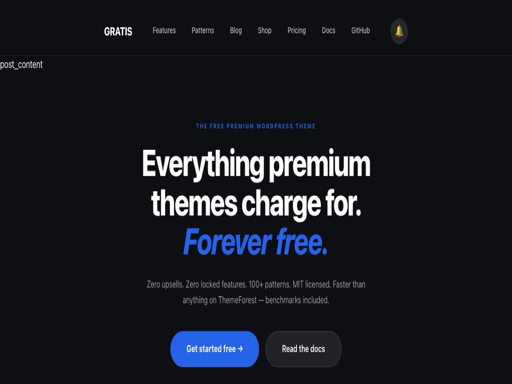

# GRATIS — Full Site Editing WordPress Block Theme (`v1.0.2`)

> Everything premium themes charge for. Forever free.

[](https://www.gnu.org/licenses/gpl-2.0.html)
[](https://wordpress.org)
[](https://php.net)

- **Live Theme Demo:** [gratis.superglobalsdevelopment.com/demo/gratis-theme/](https://gratis.superglobalsdevelopment.com/demo/gratis-theme/)
- **Theme Documentation:** [gratis.superglobalsdevelopment.com/docs/gratis-theme/](https://gratis.superglobalsdevelopment.com/docs/gratis-theme/)
- **Download Latest ZIP:** [gratis-theme-1.0.2.zip](https://gratis.superglobalsdevelopment.com/downloads/gratis-theme-1.0.2.zip)



---

## Overview

GRATIS (`gratis`, `v1.0.2`) is a Full Site Editing (FSE) WordPress block theme built around `theme.json` v3, self-hosted OFL fonts, and 1:1 Gutenberg Edit Mode to Published Frontend parity. There is no paid Pro tier, no license key, and no jQuery dependency.

| Capability | GRATIS (`v1.0.2`) |
|---|---|
| Price & License | **$0 forever** (GPL-2.0-or-later) |
| Block Patterns | **22 patterns** across **19 registered categories** |
| Custom Block Styles | **17 registered styles** across 6 core block types |
| Global Style Variations | **4 variations** (`dark.json`, `light.json`, `emerald.json`, `ocean.json`) |
| FSE Templates & Parts | **18 templates** (`templates/*.html`) + **5 template parts** (`parts/*.html`) |
| Frontend JS | **0 KB jQuery** (`~7 KB` vanilla JS for search, notifications, and reveal) |
| Fonts & Illustrations | **Self-hosted** Space Grotesk + DM Sans (OFL 1.1) + local SVG artwork |

---

## Installation

### WordPress Admin
1. Download [`gratis-theme-1.0.2.zip`](https://gratis.superglobalsdevelopment.com/downloads/gratis-theme-1.0.2.zip).
2. Go to **Appearance → Themes → Add New → Upload Theme**.
3. Upload the ZIP and click **Activate**.

### WP-CLI
```bash
wp theme install https://github.com/juslintek/gratis-theme/archive/main.zip --activate
```

### Development
```bash
git clone git@github.com:juslintek/gratis-theme.git wp-content/themes/gratis-theme
wp theme activate gratis-theme
```

---

## 1:1 Gutenberg Edit-Mode Parity

Both the iframed Post Editor / Site Editor (`add_theme_support('editor-styles')` + `add_editor_style()`) and the published frontend (`wp_enqueue_scripts`) load the exact same stylesheets and normalized `theme.json` v3 tokens:

- `assets/css/theme.css` — layout, root resets, typography, surfaces, and custom block styles
- `assets/css/components.css` — live search, toast/bell notifications, tables, code blocks, and cards
- `assets/css/demo-showcase.css` — showcase grid and hero styles on demo/CPT views

Scroll-reveal rules are scoped to frontend `prefers-reduced-motion: no-preference`, so blocks stay visible (`opacity: 1`) and static while editing in Gutenberg. Every pattern, template, and template part uses canonical core block markup with zero "Attempt Block Recovery" prompts.

---

## Design System (`theme.json` v3) & 4 Style Variations

- **18 Color Palette Tokens:** `base`, `base-2`, `base-3`, `base-dark`, `surface`, `surface-2`, `contrast`, `contrast-2`, `contrast-3`, `primary`, `primary-dark`, `primary-light`, `accent`, `accent-light`, `success`, `warning`, `danger`, `border`
- **3 Gradients:** `primary-to-accent`, `dark-to-primary`, `subtle`
- **Fluid Typography (`clamp()`):** `xs`, `sm`, `md`, `lg`, `xl`, `2-xl`, `3-xl`, `4-xl`, `5-xl` using self-hosted `Space Grotesk` (headings), `DM Sans` (body), and system monospace (zero Google Fonts CDN requests)
- **Spacing, Shadows & Radius:** 13 spacing presets (`1`–`32`), 6 shadow presets (`xs`–`2-xl`), and 5 border-radius presets (`sm`, `md`, `lg`, `xl`, `2xl`, plus `full`)

Switch palettes anytime in **Appearance → Editor → Styles**:

| Variation | File | Character |
|---|---|---|
| **Obsidian Dark** | `styles/dark.json` | Default dark slate canvas with emerald primary accent |
| **Daylight Light** | `styles/light.json` | Clean white surface with high-contrast slate ink |
| **Emerald Matrix** | `styles/emerald.json` | Deep forest green dark palette with emerald highlights |
| **Ocean Slate** | `styles/ocean.json` | Deep navy surface with sky-blue primary accents |

---

## All 22 Block Patterns (19 Categories)

Registered pattern categories: `gratis-heroes`, `gratis-sections`, `gratis-cards`, `gratis-cta`, `gratis-features`, `gratis-pricing`, `gratis-team`, `gratis-testimonials`, `gratis-stats`, `gratis-faq`, `gratis-forms`, `gratis-navigation`, `gratis-footer`, `gratis-blog`, `gratis-portfolio`, `gratis-woocommerce`, `gratis-membership`, `gratis-about`, `gratis-contact`.

| Pattern Title | Slug | Categories |
|---|---|---|
| About — Split with Image | `gratis/about-split` | `gratis-about` |
| Content — Alternating Image Text | `gratis/alternating-sections` | `gratis-sections` |
| Blog — Latest Posts Grid | `gratis/blog-grid` | `gratis-blog` |
| Comparison — vs Competitors | `gratis/comparison-table` | `gratis-sections` |
| Contact — Split Layout | `gratis/contact-split` | `gratis-contact`, `gratis-forms` |
| CTA — Centered Banner | `gratis/cta-centered` | `gratis-cta` |
| FAQ — Accordion | `gratis/faq` | `gratis-faq` |
| Features — 3 Column Grid | `gratis/features-grid` | `gratis-features` |
| Hero — Bold Centered | `gratis/hero-bold` | `gratis-heroes` |
| Hero — Gradient | `gratis/hero-gradient` | `gratis-heroes` |
| Hero — Minimal | `gratis/hero-minimal` | `gratis-heroes` |
| Hero — Split Image | `gratis/hero-split` | `gratis-heroes` |
| Product Landing — Gratis Suite | `gratis-theme/landing-product` | `gratis-sections`, `gratis-heroes`, `featured` |
| Logo Bar — Trusted By | `gratis/logo-bar` | `gratis-sections` |
| Membership — Content Gate | `gratis/membership-gate` | `gratis-membership` |
| Newsletter — Inline Signup | `gratis/newsletter` | `gratis-forms`, `gratis-cta` |
| Portfolio — Masonry Grid | `gratis/portfolio-grid` | `gratis-portfolio` |
| Pricing — 3 Cards | `gratis/pricing-cards` | `gratis-pricing` |
| Stats — Counter Row | `gratis/stats-row` | `gratis-stats` |
| Team — Cards | `gratis/team-cards` | `gratis-team` |
| Testimonials — Grid | `gratis/testimonials-grid` | `gratis-testimonials` |
| Timeline — Vertical | `gratis/timeline` | `gratis-sections` |

---

## All 17 Custom Block Styles (`register_block_style`)

| Core Block | Registered Styles |
|---|---|
| `core/button` | `outline`, `ghost`, `pill`, `icon-only` |
| `core/group` | `card`, `card-dark`, `glass`, `bordered` |
| `core/image` | `rounded`, `shadow`, `border` |
| `core/list` | `check`, `no-disc` |
| `core/quote` | `large`, `plain` |
| `core/separator` | `thick`, `dotted` |

---

## 18 FSE Templates & 5 Template Parts

- **Core Templates (`templates/*.html`):** `index`, `single`, `page`, `archive`, `search`, `404`, `blank`, `full-width`, `landing`, `page-search-page`
- **WooCommerce Templates:** `archive-product`, `single-product`, `page-cart`, `page-checkout`
- **Gratis Suite CPT Templates:** `archive-gratis_doc`, `single-gratis_doc`, `archive-gratis_event`, `archive-gratis_course`
- **Template Parts (`parts/*.html`):** `header`, `header-dark`, `header-minimal`, `footer`, `footer-minimal`

---

## Interactive Vanilla JS Components (`0 KB` jQuery, `~7 KB` JS)

### Live REST Search (`assets/js/search.js`)

Debounced (200ms) search against `/wp-json/wp/v2/search` using `AbortController` and safe `createElement` + `textContent` DOM rendering. Add anywhere with a Custom HTML block:

```html
<div class="gratis-search-wrap">
  <input type="search" class="gratis-search-input" aria-label="Search site" placeholder="Search...">
</div>
```

### Toast & Bell Notifications (`assets/js/notifications.js`)

Provides `window.GRATIS.toast()` and `window.GRATIS.notify()` (including a WooCommerce `added_to_cart` listener):

```javascript
GRATIS.toast("Changes saved cleanly.", "success");
GRATIS.toast("Connection timed out.", "error", 8000);
GRATIS.notify("New order #1042 received", "info", "/orders/1042");
```

Bell panel markup:

```html
<div class="gratis-bell" tabindex="0" role="button" aria-label="Open notifications panel">
  <span class="gratis-bell-icon" aria-hidden="true">🔔</span>
  <span class="gratis-bell-badge" aria-live="polite"></span>
  <div class="gratis-bell-panel">
    <div class="gratis-bell-panel-header">Notifications</div>
    <div class="gratis-bell-list"></div>
  </div>
</div>
```

### Scroll Reveal (`assets/js/animations.js`)

`IntersectionObserver` reveal for `.gratis-reveal` elements, strictly gated behind `@media (prefers-reduced-motion: no-preference)`.

---

## Accessibility & Performance

- Skip link (`.gratis-skip-link`), keyboard-accessible `wp:details` FAQ accordions, 44x44px touch targets, and WCAG AA contrast tokens across all 4 style variations
- Zero external font CDN calls, zero jQuery, and zero plugin-territory meta/cache hooks in `functions.php` (SEO and cache headers live in `gratis-seo` and `gratis-cache`)

---

## Requirements & License

- WordPress 6.5+ (tested up to 7.1)
- PHP 7.4+ (8.1+ recommended)
- GPL-2.0-or-later — see [LICENSE](https://www.gnu.org/licenses/gpl-2.0.html)
- Standalone theme validation: `php tests/validate-theme.php`
